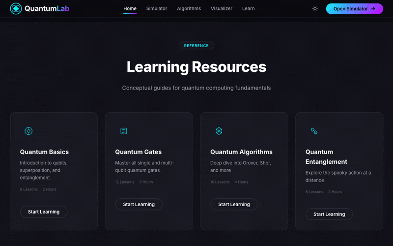
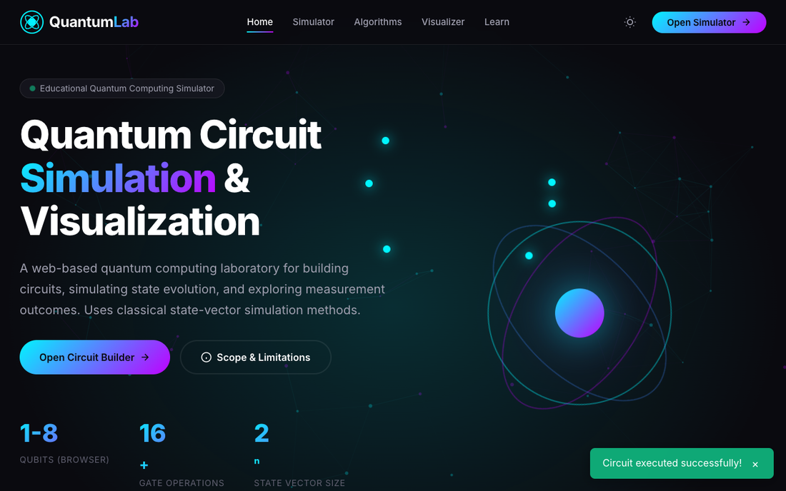
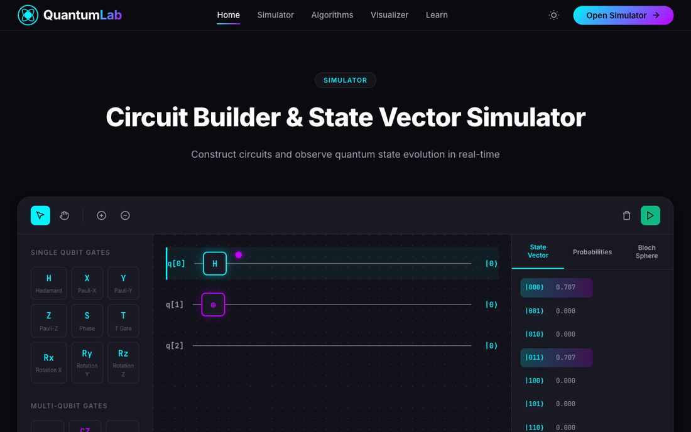
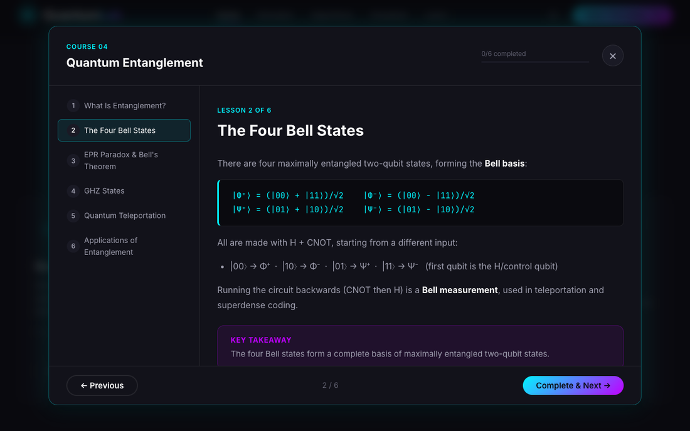

# QuantumLab

A browser-based quantum circuit simulator and learning platform.


🔗 **[Live Demo](https://quantum-circuit-lab.netlify.app)**



## Features

- **Circuit Builder** — drag and drop gates (H, X, Y, Z, S, T, Rx/Ry/Rz, CNOT, CZ, SWAP, Toffoli)
- **State Vector Simulation** — live amplitudes, probabilities and Bloch sphere
- **Algorithms** — Grover, QFT, VQE, QAOA and BB84 presets
- **Learning Resources** — 4 courses, 36 lessons and quizzes, each lesson opens in the simulator
- **Code Export** — Qiskit, Cirq and Q#

## Screenshots







## Getting Started

```bash
git clone https://github.com/rasidi3112/quantum-lab-circuit.git
cd quantum-lab-circuit
npx serve .
```

No build step needed. It is a static site that can be deployed directly to Netlify.

## License

MIT, see [LICENSE](LICENSE).
